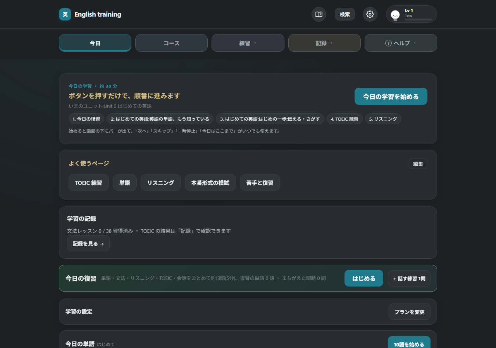
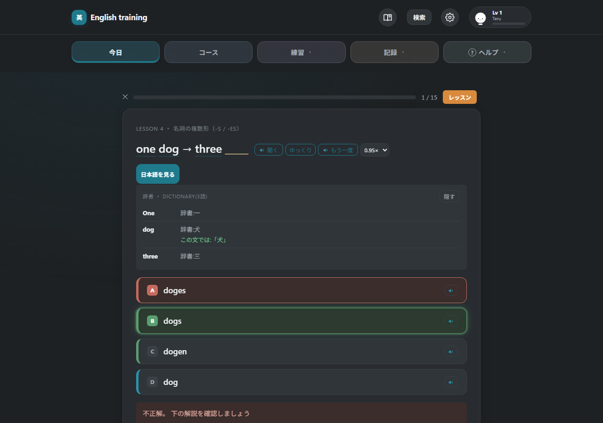
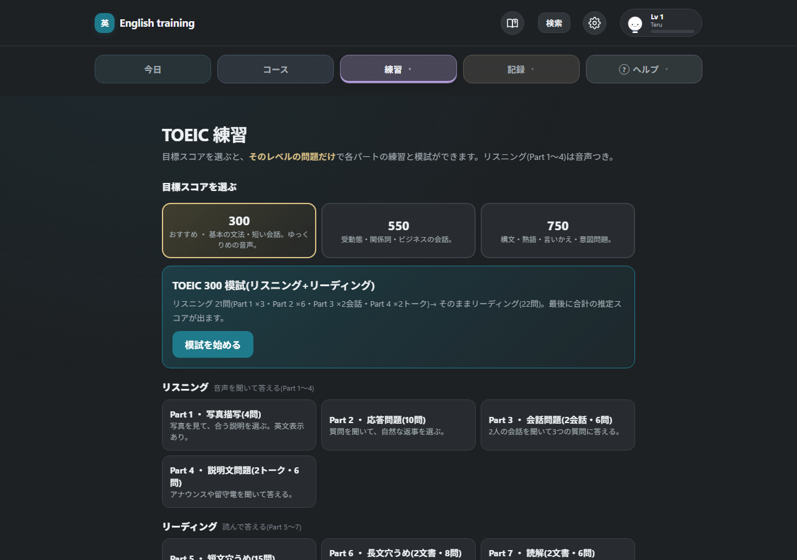
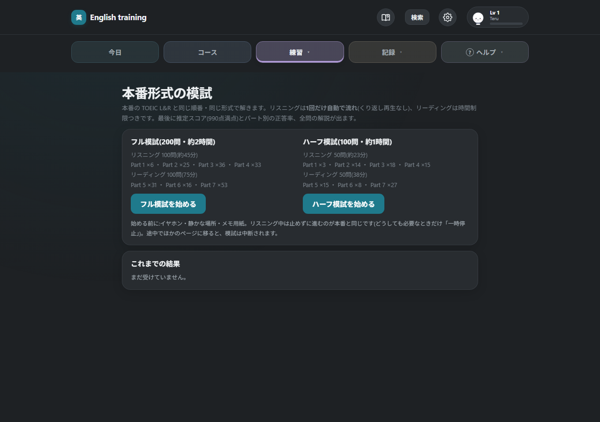
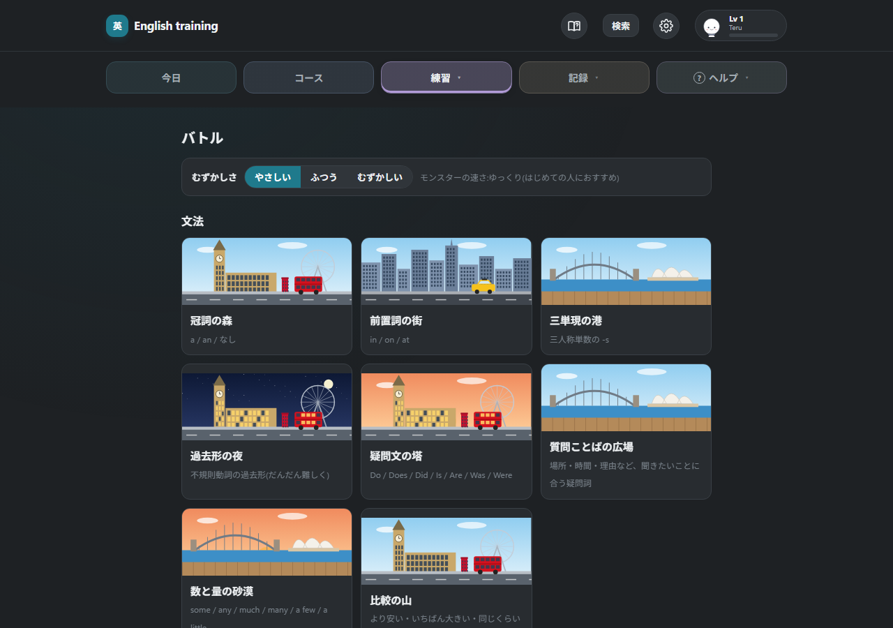
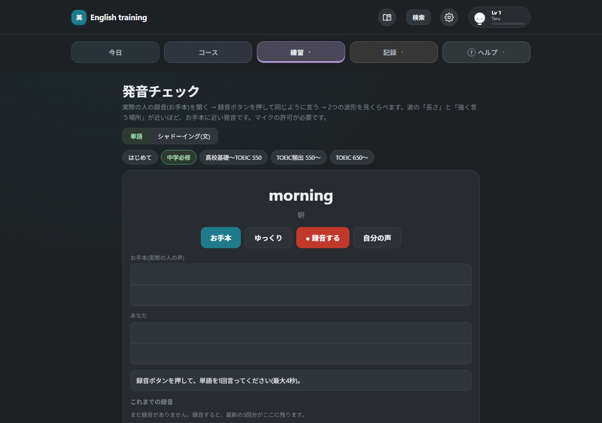
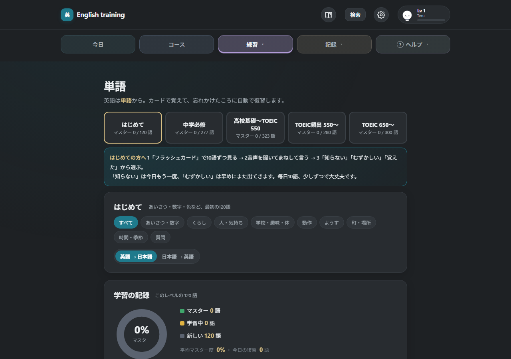
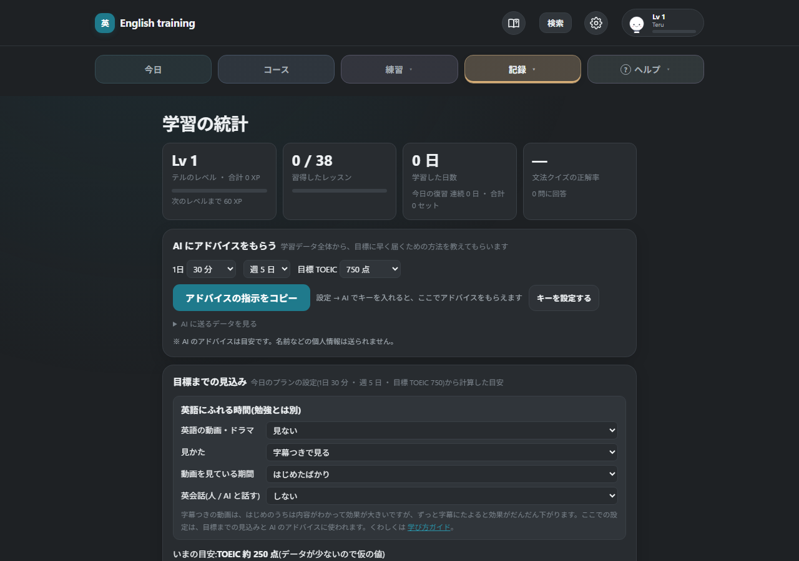
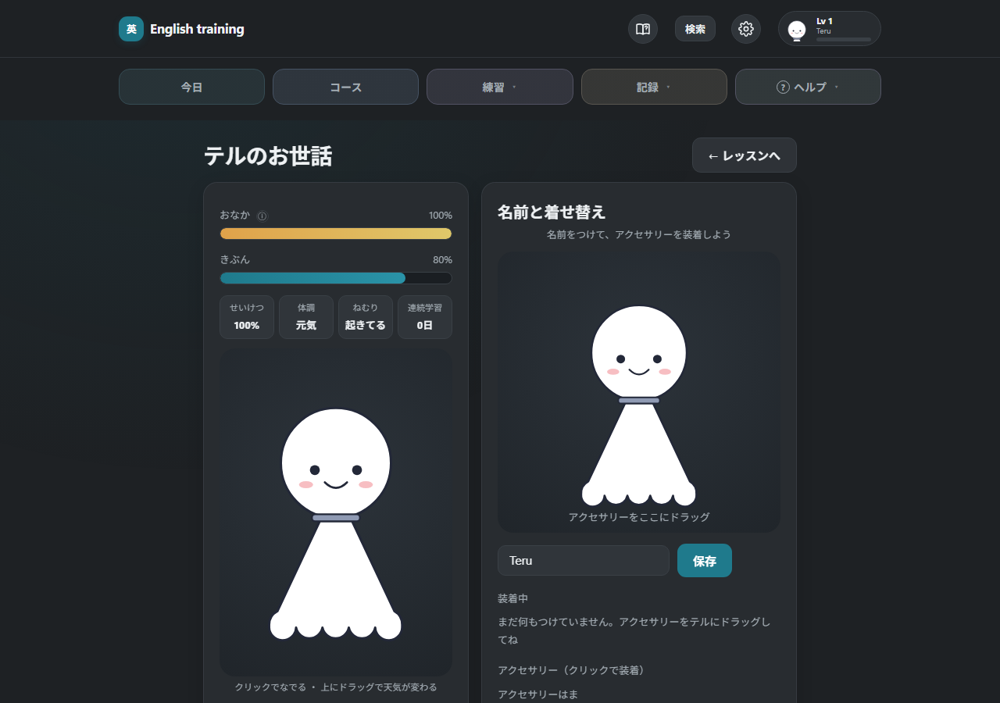
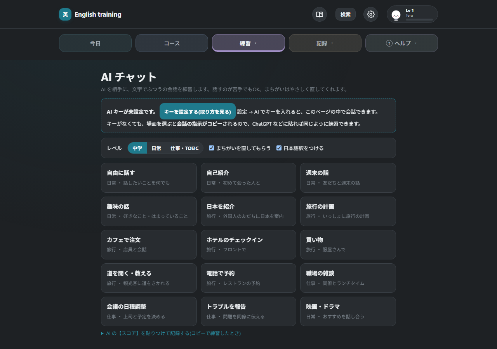

# てるてる英語トレーニング — 使い方ガイド / User Guide
**English training (enhanced) · v171 · 2026-11-26**

各見出しの下:日本語の説明 → **EN:** 英語の説明 → スクリーンショット → 画面に出ている文字の英訳表。  
_Under each heading: Japanese description → English description → screenshot → table translating the on-screen text._

## 目次 / Contents

- [1. このサイトについて](#about)
- [2. 今日(ホーム) — 毎日のスタート地点](#today)
- [3. コース — Unit 0〜38 を順番に](#course)
- [4. レッスン(スライド)](#lesson)
- [5. クイズ — すべての選択肢に解説](#quiz)
- [6. TOEIC 練習(Part 1〜7)](#toeic)
- [7. 本番形式の模試](#mock)
- [8. 速読トレーナー(Part 7)](#speed)
- [9. バトル — 文法ゲーム](#battle)
- [10. 会話練習(40場面)](#kaiwa)
- [11. 発音チェック](#hatsuon)
- [12. リスニング練習](#listen)
- [13. 単語](#vocab)
- [14. 苦手分析と復習](#weak)
- [15. 学習の統計](#stats)
- [16. てるのお世話(My Teru)](#teru)
- [17. AI チャット(任意・自分のキー)](#ai)
- [18. 設定(⚙)・検索・ヘルプ](#settings)

## 1. このサイトについて
_場所 / Where: 概要_

日本人学習者のための英語トレーニングサイトです。HTMLファイル1つだけで動き、サーバーもインストールも不要。EdgeまたはChromeで開けばすぐ使えます。38レッスン・約1,060問の文法クイズ、40場面の会話練習、TOEIC 300/550/750の練習と本番形式の模試、文法バトルゲーム、発音チェック、苦手分析とSRS復習を搭載。マスコットの「てる」が毎日の学習を見守ります。学習記録はすべてブラウザ内に保存され、外部には送信されません。

> **EN:** An English-training site for Japanese learners. It is a single HTML file — no server, no install — that runs in Edge or Chrome. It contains 38 grammar lessons with ~1,060 quiz questions, 40 conversation scenes, TOEIC practice at 300/550/750 plus full-length mock tests, a grammar battle game, a pronunciation checker, weak-point analysis and spaced-repetition review. The mascot 'Teru' (a teru-teru-bōzu rain doll) watches over daily study. All progress is stored in the browser only; nothing is uploaded.

### 使い方 / How to run
- 「English training (enhanced).html」をダウンロード → EdgeかChromeでダブルクリック。それだけです。  
  _Download the file → double-click it in Edge or Chrome. That's all._
- 単語の音声だけオンライン(Wikimedia Commons → なければ端末の音声合成)。ほかはオフラインで動きます。  
  _Only word audio needs internet (streamed from Wikimedia Commons, falls back to the device's text-to-speech). Everything else works offline._
- スマホでも同じファイルで動きます(320px幅から対応)。  
  _The same file works on phones (down to 320 px wide)._

### 知っておくべきこと / Things to know
- **テーマ:** 初期設定はダーク。設定(⚙)でライト/自動に変更可。  
  _Theme: dark by default; switch to light/auto in Settings (⚙)._
- **キーボード:** Space/Enter で次へ、Backspace で戻る、「/」でホーム検索。  
  _Keyboard: Space/Enter advances slides and quiz items, Backspace goes back, '/' opens search._
- **データ:** ブラウザのサイトデータを消すと記録も消えます。設定からエクスポート/インポートできます。  
  _Data: clearing browser site data erases progress. Export/import is in Settings._
- **AI機能は任意:** 自分のAPIキー(Gemini/OpenAI/Anthropic/DeepSeek/xAI)を設定すると、クイズの振り返り・苦手の相談・チャットが可能。キーは端末内のみに保存。  
  _AI features are optional. Enter your own API key and you get quiz review, weak-point coaching and chat. The key never leaves the device._

## 2. 今日(ホーム) — 毎日のスタート地点
_場所 / Where: 今日 タブ_

毎日ここから始めます。「今日の学習を始める」を押すだけで、今日の復習 → いまのユニットのレッスン → 使ってみる → 単語・TOEIC・リスニングへと順番に自動で進みます(約30分)。始めると画面下にバーが出て「次へ・スキップ・一時停止・今日はここまで」がいつでも使えます。タイマーはなく、せかされません。

> **EN:** Start here every day. Press 'Start today's study' and the site walks you through: today's review → the current unit's lesson → 'try it out' → vocabulary, TOEIC and listening (about 30 minutes). A bar at the bottom offers Next / Skip / Pause / Stop for today. There is no timer and no pressure.

_今日タブ / Today tab_

| 画面の文字 / On-screen text | 英訳 / English |
|---|---|
| 今日 / コース / 練習 / 記録 / ヘルプ | Today / Course / Practice / Records / Help (main tabs) |
| 検索 / ⚙ / Lv 1 Teru | Search / Settings / Teru level 1 (click to open My Teru) |
| 今日の学習 · 約 30 分 — ボタンを押すだけで、順番に進みます | Today's study · about 30 min — Just press the button and it goes in order |
| いまのユニット: Unit 0 はじめての英語 | Current unit: Unit 0 'First English' |
| 1. 今日の復習 2. はじめての英語: 英語の単語、もう知っている 3. はじめの一歩: 伝える・さがす 4. TOEIC 練習 5. リスニング | 1. Today's review 2. First English: English words you already know 3. First steps: telling & finding 4. TOEIC practice 5. Listening |
| 始めると画面の下にバーが出て、「次へ」「スキップ」「一時停止」「今日はここまで」がいつでも使えます。 | Once started, a bar appears at the bottom with Next / Skip / Pause / Done for today. |
| 今日の学習を始める | Start today's study |
| よく使うページ: TOEIC 練習 / 単語 / リスニング / 本番形式の模試 / 苦手と復習 (編集) | Frequently used pages: TOEIC practice / Vocabulary / Listening / Real-format mock test / Weak points & review (Edit) |
| 学習の記録 — 文法レッスン 0 / 38 習得済み · TOEIC の結果は「記録」で確認できます — 記録を見る → | Study records — Grammar lessons mastered 0 / 38 · TOEIC results are in 'Records' — View records → |
| 今日の復習 — 単語・文法・リスニング・TOEIC・会話をまとめて約13問(5分)。復習の単語 0 語 · まちがえた問題 0 問 — はじめる / + 話す練習 1問 | Today's review — vocabulary, grammar, listening, TOEIC and conversation together, ~13 items (5 min). Words to review: 0 · Missed questions: 0 — Start / + 1 speaking item |
| 学習の設定 — プランを変更 | Study settings — Change plan |
| 今日の単語 はじめて — 10語を始める | Today's words (Beginner) — Start 10 words |

## 3. コース — Unit 0〜38 を順番に
_場所 / Where: コース タブ_

上から順番に進むコースです。各ユニットは「レッスン(文法)→ 使ってみる(同じ文法で話す・書く)」の2ステップ。入門(はじめての英語)→ 基礎(中学〜TOEIC 300)→ 日常で使う文法(TOEIC 550)→ 上級の順に並んでいます。「続きから」で前回の場所に戻れます。

> **EN:** A top-to-bottom course. Each unit has two steps: Lesson (grammar) → Try it out (speak/write with the same grammar). Groups: Intro (First English) → Basics (junior-high to TOEIC 300) → Everyday grammar (TOEIC 550) → Advanced. 'Continue' returns you to where you left off.

_コースタブ / Course tab_

| 画面の文字 / On-screen text | 英訳 / English |
|---|---|
| コース — 上から順番に進むコースです。各ユニットはレッスン(文法)→ 使ってみる(同じ文法で話す・書く)の2ステップ。「今日の学習」を始めると、いまのユニットから自動で進みます。 | Course — Progress from the top. Each unit = Lesson (grammar) → Try it out (speak/write with that grammar). 'Today's study' automatically continues from the current unit. |
| 0 / 51 ユニット完了 · いまのユニット: Unit 0 はじめての英語 — 今日の学習を始める | 0 / 51 units complete · Current unit: Unit 0 First English — Start today's study |
| いまのユニット — Unit 0 · はじめての英語 — 続きから / 開く | Current unit — Unit 0 · First English — Continue / Open |
| すべて表示 | Show all |
| はじめての英語 (入門) — Unit 0 · はじめての英語 — 日本語とくらべてわかる入門 · 0 / 13 レッスン — 開く / とばす | First English (Intro) — Unit 0 · First English — An intro that compares with Japanese · 0 / 13 lessons — Open / Skip |
| 基礎 — 基礎(中学〜TOEIC 300) | Basics — (junior high to TOEIC 300) |
| 日常で使う文法 — 中級(TOEIC 550) | Everyday grammar — Intermediate (TOEIC 550) |

## 4. レッスン(スライド)
_場所 / Where: コース → 開く_

1レッスンは10〜15枚のスライド。文法の「形」→ なぜそうなるか → 例文(音声つき)→ よくある間違い、の順です。矢印キーまたは Space で進みます。「まとめだけ見る」「クイズへスキップ」も選べます。

> **EN:** A lesson is 10–15 slides: the grammar 'shape' → why it works that way → example sentences with audio → common mistakes. Advance with the arrow buttons or Space. You can also jump to 'summary only' or 'skip to quiz'.

_レッスン4「名詞の複数形」のスライド / Lesson 4 'Plural nouns' slide_

| 画面の文字 / On-screen text | 英訳 / English |
|---|---|
| 2 / 12 · Lesson 4 / 38 · 名詞の複数形(-s / -es) | Slide 2 of 12 · Lesson 4 of 38 · Plural nouns (-s / -es) |
| (名詞) + s | (noun) + s |
| 基本は -s をつけるだけ。2つ以上なら必ずつけます。 | Basically just add -s. If there are two or more, you must add it. |
| ← / → | Back / Next |
| まとめだけ見る / クイズへスキップ / ダッシュボードに戻る | Summary only / Skip to quiz / Back to dashboard |

## 5. クイズ — すべての選択肢に解説
_場所 / Where: レッスンのあと_

各レッスンに15問。英文と「日本語を見る」ボタン、辞書(文中の単語の意味)、音声(ふつう/ゆっくり/もう一度/速度)がついています。答えると正解が緑、自分の誤答が赤で表示され、下に「なぜ間違いか・どう直すか」の解説が出ます。復習問題(🔁 Review)が毎回混ざりますが、合格判定には数えません。80%以上で合格です。

> **EN:** Each lesson has a 15-question quiz. Every item shows the English sentence, a 'Show Japanese' button, a mini-dictionary for the words in the sentence, and audio (normal / slow / again / speed). After answering, the correct choice turns green and your wrong choice red, with an explanation of why it is wrong and how to fix it. Review items (🔁) are mixed in but do not count toward the 80% pass mark.

_誤答したあとの画面 / After a wrong answer_

| 画面の文字 / On-screen text | 英訳 / English |
|---|---|
| 1 / 15 · レッスン | Question 1 of 15 · (button) back to lesson |
| LESSON 4 · 名詞の複数形(-s / -es) | Lesson 4 · Plural nouns (-s / -es) |
| one dog → three ____  🔊聞く / ゆっくり / もう一度 / 0.95× | one dog → three ____  Listen / Slow / Again / speed 0.95× |
| 日本語を見る | Show Japanese |
| 辞書 · DICTIONARY(3語) — One 辞書: 一 / dog 辞書: 犬 この文では:「犬」/ three 辞書: 三 — 隠す | Dictionary (3 words) — One: one / dog: dog, in this sentence: 'dog' / three: three — Hide |
| A doges(赤) B dogs(緑) C dogen D dog | A doges (your wrong answer, red) B dogs (correct, green) C dogen D dog |
| 不正解。下の解説を確認しましょう | Incorrect. Check the explanation below. |

## 6. TOEIC 練習(Part 1〜7)
_場所 / Where: 練習 → TOEIC 練習_

TOEIC L&R の全パートを短く練習できます。レベル(300/550/750)を選び、パートごとに10問前後。Part 1 は実写真(Wikimedia Commons)を見て4つの説明文から正しいものを選びます。すべての問題に日本語の解説つき。

> **EN:** Short drills for every part of the TOEIC L&R. Choose a level (300/550/750) and a part; about 10 items each. Part 1 uses real photos (Wikimedia Commons) with four spoken statements. Every item has a Japanese explanation.

_TOEIC 練習ページ / TOEIC practice page_

| 画面の文字 / On-screen text | 英訳 / English |
|---|---|
| TOEIC 練習 | TOEIC practice |
| レベル: TOEIC 300 / 550 / 750 | Level: TOEIC 300 / 550 / 750 |
| リスニング Part 1 写真描写 / Part 2 応答 / Part 3 会話 / Part 4 説明文 | Listening Part 1 Photographs / Part 2 Question–Response / Part 3 Conversations / Part 4 Talks |
| リーディング Part 5 短文穴埋め / Part 6 長文穴埋め / Part 7 読解 | Reading Part 5 Incomplete sentences / Part 6 Text completion / Part 7 Reading comprehension |
| 始める | Start |

## 7. 本番形式の模試
_場所 / Where: 練習 → 本番形式の模試_

本番と同じ順番・同じ形式。リスニングは1回だけ自動で流れ、リーディングは時間制限あり。最後に推定スコア(990点満点)とパート別正答率、全問の解説が出ます。フル(200問・約2時間)とハーフ(100問・約1時間)。※このサイトでタイマーがあるのは模試と速読だけです。

> **EN:** Same order and format as the real test. Listening plays once automatically; reading is timed. At the end you get an estimated score (out of 990), per-part accuracy and explanations for every question. Full (200 Q, ~2 h) or Half (100 Q, ~1 h). Note: the mock test and speed-reading trainer are the only timed activities on the site.

_模試の入口 / Mock test entry_

| 画面の文字 / On-screen text | 英訳 / English |
|---|---|
| 本番形式の模試 — 本番の TOEIC L&R と同じ順番・同じ形式で解きます。リスニングは1回だけ自動で流れ(くり返し再生なし)、リーディングは時間制限つきです。最後に推定スコア(990点満点)とパート別の正答率、全問の解説が出ます。 | Real-format mock test — Same order and format as the real TOEIC L&R. Listening plays once automatically (no replay); reading is timed. At the end: estimated score (max 990), per-part accuracy, explanations for all questions. |
| フル模試(200問・約2時間) — リスニング 100問(約45分) Part 1 ×6 · Part 2 ×25 · Part 3 ×36 · Part 4 ×33 / リーディング 100問(75分) Part 5 ×31 · Part 6 ×16 · Part 7 ×53 — フル模試を始める | Full test (200 Q, ~2 h) — Listening 100 Q (~45 min) ... / Reading 100 Q (75 min) ... — Start full test |
| ハーフ模試(100問・約1時間) ... — ハーフ模試を始める | Half test (100 Q, ~1 h) ... — Start half test |
| 始める前に: イヤホン・静かな場所・メモ用紙。リスニング中は止めずに進むのが本番と同じです(どうしても必要なときだけ「一時停止」)。途中でほかのページに移ると、模試は中断されます。 | Before you start: earphones, a quiet place, note paper. Like the real test, do not stop during listening (use Pause only if you must). Leaving to another page aborts the test. |
| これまでの結果 — まだ受けていません。 | Past results — none yet. |

## 8. 速読トレーナー(Part 7)
_場所 / Where: 練習 → 速読_

時間内に Part 7 を読み終わらない人のためのトレーナー。文書を時間をはかって読み、問題に答え、WPM(1分あたりの語数)と正答率を記録します。目標レベルごとの目安 WPM と、速く読むコツも表示。

> **EN:** For people who run out of time on Part 7. Read a passage against the clock, answer questions, and log words-per-minute and accuracy. Shows target WPM per level and tips for reading faster.

_速読トレーナー / Speed-reading trainer_

| 画面の文字 / On-screen text | 英訳 / English |
|---|---|
| 速読トレーナー(Part 7) — TOEIC の Part 7 は、時間内に読み終わらない人がとても多いパートです。文書を時間をはかって読み、そのあと問題に答えて、読む速さ(1分あたりの語数 = WPM)と正答率を記録します。 | Speed-reading trainer (Part 7) — Many people cannot finish Part 7 in time. Read a passage timed, then answer questions; your speed (WPM) and accuracy are recorded. |
| 目標レベル: TOEIC 300(目標 100 WPM) / TOEIC 550(目標 130 WPM) / TOEIC 750(目標 160 WPM) | Target level: TOEIC 300 (100 WPM) / 550 (130 WPM) / 750 (160 WPM) |
| 本番で Part 7 を最後まで解くには、だいたい 150 WPM くらいの速さが必要です。まずは目標レベルのペースを目指しましょう。黄色のバーは「目標ペースならここまで読める」という目安です。 | To finish Part 7 on the real test you need roughly 150 WPM. Aim for your level's pace first. The yellow bar shows how far you'd be at the target pace. |
| 文書をひとつ読む | Read one passage |
| これまでの記録 — まだ記録がありません。 | Records — none yet. |
| 速く読むコツ: 1語ずつ日本語にしない。英語の語順のまま、かたまりで読む。/ 読み返さない。わからない単語があっても、まず最後まで読む。/ メールなら「だれが・だれに・何のために」、広告なら「何を・いくらで・いつまで」を先につかむ。/ 本番では、先に設問を見てから本文を読むのも有効です。 | Tips: Don't translate word by word — read in chunks in English order. / Don't re-read; finish first even with unknown words. / For emails grasp who-to whom-why; for ads what-price-until when. / On the real test, reading the questions first can help. |

## 9. バトル — 文法ゲーム
_場所 / Where: 練習 → バトル_

モンスターが歩いてくる間に文法問題に答えるゲーム。6ステージ(冠詞 / 前置詞 / 三単現 / 不規則過去形 / 疑問文 / 疑問詞)+ 数と量・比較、エンドレスモード。難易度3段階。間違えると時間が止まり、1行のルールが2秒表示されます。10体倒すとボス。XPとてるのごはんがもらえ、連続学習日数にも数えられます。

> **EN:** Answer grammar questions while monsters walk toward you. Six stages (articles / prepositions / third-person -s / irregular past / questions / question words) plus quantity & comparison and an endless mode; three difficulty levels. A wrong answer freezes time and shows a one-line rule for two seconds. A boss appears after 10 monsters. Earns XP and food for Teru and counts toward your daily streak.

_バトルのステージ選択 / Battle stage select_

| 画面の文字 / On-screen text | 英訳 / English |
|---|---|
| バトル | Battle |
| むずかしさ: やさしい / ふつう / むずかしい — モンスターの速さ: ゆっくり(はじめての人におすすめ) | Difficulty: Easy / Normal / Hard — Monster speed: slow (recommended for beginners) |
| 文法 | Grammar |
| 冠詞の森 — a / an / なし | Forest of Articles — a / an / none |
| 前置詞の街 — in / on / at | City of Prepositions — in / on / at |
| 三単現の港 — 三人称単数の -s | Harbor of Third-Person -s |
| 過去形の夜 — 不規則動詞の過去形(だんだん難しく) | Night of the Past Tense — irregular past forms (gets harder) |
| 疑問文の塔 — Do / Does / Did / Is / Are / Was / Were | Tower of Questions |
| 質問ことばの広場 — 場所・時間・理由など、聞きたいことに合う疑問詞 | Plaza of Question Words — which wh-word fits (place, time, reason...) |
| 数と量の砂漠 — some / any / much / many / a few / a little | Desert of Quantity |
| 比較の山 — より安い・いちばん大きい・同じくらい | Mountain of Comparison — cheaper, biggest, as...as |

## 10. 会話練習(40場面)
_場所 / Where: 練習 → リスニング → 会話練習_

相手の英語を聞く → 正しい返事を選ぶ → 声に出して言う、をくり返します。カフェ・道案内・電話・会議・買い物など40場面・120ターン。答えたあとに「ほかにも自然な言い方」が2つ表示されます。マイクを使うと認識された単語とお手本の一致を表示(採点ではありません)。間違えた場面は、ほかの場面の中に復習として再登場します。

> **EN:** Listen to the other person → choose the right reply → say it aloud, repeated across 40 scenes / 120 turns (café, directions, phone, meetings, shopping...). After each answer two 'other natural ways to say it' are shown. With a microphone you see which words were recognised vs. the model (not a score). Scenes you missed reappear as review inside other scenes.

_会話練習 / Conversation practice_

| 画面の文字 / On-screen text | 英訳 / English |
|---|---|
| 会話練習 — 相手の英語を聞く → 正しい返事を選ぶ → 声に出して言う、をくり返します。マイクは認識された単語とお手本の一致を表示します。発音や自由な返事の正しさの採点ではありません。 ← リスニング | Conversation practice — Listen → choose the correct reply → say it aloud, repeatedly. The mic shows which recognised words match the model; it does not grade pronunciation or free answers. ← Listening |
| 話せるようになる · はじめの3場面 — 短い会話で「聞く → 自分で返事を考える → 答えを比べる」。マイク・AI はなくても使えます。選択問題の結果と、実際に話せる力は別のものです。 | Learn to speak · First 3 scenes — Short dialogues: listen → think of your own reply → compare. Works without mic or AI. Multiple-choice results and real speaking ability are different things. |
| 1. 自己紹介する 2. 注文する 3. 道を案内する — 未挑戦 | 1. Introduce yourself 2. Order 3. Give directions — not attempted |
| ☐ 選択肢を見る前に、声に出して答える | ☐ Answer aloud before seeing the choices |
| すべて / 中学 / TOEIC 550 / TOEIC 650 — すべての場面 / 学校 / 仕事 / 日常・旅行 | All / Junior high / TOEIC 550 / TOEIC 650 — All scenes / School / Work / Daily life & travel |
| カフェで注文する — あなたはカフェにいます。コーヒーを持ち帰りで注文しましょう。 | Ordering at a café — You are in a café. Order a coffee to go. |
| 道をたずねられる — 駅の近くで、旅行者に道を聞かれました。 | Asked for directions — Near the station a traveller asks you the way. |
| 電話で予約を変更する — ホテルに電話して、予約の日にちを5月10日から12日に変更します。 | Changing a booking by phone — Call the hotel and move your booking from May 10 to 12. |
| 会議の日程を調整する / 服を試着する / 自己紹介をする | Rescheduling a meeting / Trying on clothes / Introducing yourself |

## 11. 発音チェック
_場所 / Where: 練習 → 発音チェック_

実際の人の録音(お手本)を聞く → 録音ボタンで同じように言う → 2つの波形を見くらべます。波の長さと強く言う場所が近いほど、お手本に近い発音です。単語モードとシャドーイング(文)モード。マイクの許可が必要です。

> **EN:** Listen to a real human recording → record yourself saying it → compare the two waveforms. The closer the length and stress positions, the closer your pronunciation. Word mode and sentence-shadowing mode. Requires microphone permission.

_発音チェック / Pronunciation check_

| 画面の文字 / On-screen text | 英訳 / English |
|---|---|
| 発音チェック — 実際の人の録音(お手本)を聞く → 録音ボタンを押して同じように言う → 2つの波形を見くらべます。波の「長さ」と「強く言う場所」が近いほど、お手本に近い発音です。マイクの許可が必要です。 | Pronunciation check — Listen to the model (a real person) → press record and say it the same way → compare the two waveforms. Closer length and stress = closer pronunciation. Mic permission needed. |
| 単語 / シャドーイング(文) | Words / Shadowing (sentences) |
| はじめて / 中学必修 / 高校基礎〜TOEIC 550 / TOEIC頻出 550〜 / TOEIC 650〜 | Beginner / Junior-high core / High-school basics–TOEIC 550 / Frequent TOEIC 550+ / TOEIC 650+ |
| morning — 朝 | morning — (meaning) morning |
| お手本 / ゆっくり / ● 録音する / 自分の声 | Model / Slow / ● Record / My voice |
| お手本(実際の人の声) / あなた | Model (real human voice) / You |
| 録音ボタンを押して、単語を1回言ってください(最大4秒)。 | Press record and say the word once (max 4 s). |
| これまでの録音 — まだ録音がありません。録音すると、最新の3回分がここに残ります。 | Past recordings — none yet. Your latest 3 recordings are kept here. |

## 12. リスニング練習
_場所 / Where: 練習 → リスニング_

英語を耳で理解する練習。レベルを選び、聞き取り(10問)・ディクテーション(10問)・応答問題(10問)。レッスンを1つ選ぶと、そのレッスンの文だけで練習できます。似た文法の文が選択肢に混ざるので、文法で学んだ形を聞き分ける力がつきます。

> **EN:** Train your ears. Pick a level, then Listening (10 Q), Dictation (10 Q) or Question–Response (10 Q). Choosing a single lesson restricts items to that lesson's sentences. Distractors use similar grammar, so you learn to hear the forms you studied.

_リスニング練習 / Listening practice_

| 画面の文字 / On-screen text | 英訳 / English |
|---|---|
| 会話練習 — カフェ・道案内・電話・会議など、よくある場面で「聞く → 返事を選ぶ → 声に出す」 — 場面を選ぶ | Conversation practice — café, directions, phone, meetings...: listen → choose reply → say it — Choose a scene |
| リスニング練習 / 発音・聞き取りレッスン(12) | Listening practice / Pronunciation & listening lessons (12) |
| リスニング練習 — 英語を耳で理解する練習です。TOEIC の半分はリスニング。文法で学んだ文を聞き取れるようにしましょう。 | Listening practice — Understand English by ear. Half of the TOEIC is listening; learn to catch the sentences you studied in grammar. |
| レベル: すべて / TOEIC 300 / 550 / 750 | Level: All / TOEIC 300 / 550 / 750 |
| レッスン別に練習 — すべてのレッスン(上のレベルから出題) — レッスンを1つ選ぶと、そのレッスンの文だけで「聞き取り」と「ディクテーション」を練習できます(応答問題は全レッスン共通)。 | Practice by lesson — All lessons (items from the level above) — Pick one lesson to practise Listening and Dictation with only its sentences (Question–Response is shared). |
| 聞き取り(10問) — 文を聞いて、聞こえた文を4つから選ぶ。似た文法の文がまざっています。 | Listening (10 Q) — Hear a sentence, pick it from four; similar-grammar sentences are mixed in. |
| ディクテーション(10問) — 文を聞いて、そのまま書き取る。1語ずつ答え合わせ。 | Dictation (10 Q) — Hear a sentence and type it; checked word by word. |
| 応答問題(10問) | Question–Response (10 Q) |

## 13. 単語
_場所 / Where: 練習 → 単語_

5レベル・約1,300語をフラッシュカードで覚え、忘れかけたころに自動で復習(SRS)。「知らない/むずかしい/覚えた」の3択で記録。毎日10語ずつ。英→日、日→英の両方向。

> **EN:** About 1,300 words across five levels, learned with flashcards and automatically re-shown just before you forget (spaced repetition). Rate each card Don't know / Hard / Got it. Ten new words a day; English→Japanese or Japanese→English.

_単語ページ / Vocabulary page_

| 画面の文字 / On-screen text | 英訳 / English |
|---|---|
| 単語 — 英語は単語から。カードで覚えて、忘れかけたころに自動で復習します。 | Vocabulary — English starts with words. Learn with cards; review automatically just as you start to forget. |
| はじめて マスター 0 / 120 語 · 中学必修 0 / 277 · 高校基礎〜TOEIC 550 0 / 323 · TOEIC頻出 550〜 0 / 280 · TOEIC 650〜 0 / 300 | Beginner mastered 0/120 · Junior-high core 0/277 · HS basics–TOEIC 550 0/323 · Frequent TOEIC 550+ 0/280 · TOEIC 650+ 0/300 |
| はじめての方へ: 1「フラッシュカード」で10語ずつ見る → 2 音声を聞いてまねして言う → 3「知らない」「むずかしい」「覚えた」から選ぶ。「知らない」は今日もう一度、「むずかしい」は早めにまた出てきます。毎日10語、少しずつで大丈夫です。 | For beginners: 1 View 10 words at a time as flashcards → 2 Listen and repeat → 3 Choose Don't know / Hard / Got it. 'Don't know' comes back today, 'Hard' comes back soon. Ten words a day is fine. |
| はじめて — あいさつ・数字・色など、最初の120語 — すべて / あいさつ・数字 / くらし / 人・気持ち / 学校・趣味・体 / 動作 / ようす / 町・場所 / 時間・季節 / 質問 | Beginner — greetings, numbers, colours...: the first 120 words — All / Greetings & numbers / Daily life / People & feelings / School, hobbies, body / Actions / Descriptions / Town & places / Time & seasons / Questions |
| 英語 → 日本語 / 日本語 → 英語 | English → Japanese / Japanese → English |
| 学習の記録 このレベルの 120 語 — 0% マスター — マスター 0 語 / 学習中 0 語 / 新しい 120 語 — 平均マスター度 0% · 今日の復習 0 語 | Progress for this level's 120 words — 0% mastered — Mastered 0 / Learning 0 / New 120 — Avg mastery 0% · Today's review 0 words |

## 14. 苦手分析と復習
_場所 / Where: 記録 → 苦手分析_

クイズ・単語・会話・発音の結果から苦手なところを見つけ、そこだけ集中して練習できます。「今日の復習をはじめる」は苦手なところから約13問。AIキーがあれば、間違えた文法から毎回ちがう新しい問題を AI が作ります(同じ問題を暗記してしまうのを防ぐ)。

> **EN:** Finds your weak spots from quiz, vocabulary, conversation and pronunciation results, and lets you drill only those. 'Start today's review' gives ~13 items drawn from weak areas. With an AI key, the AI writes fresh questions from the grammar you missed so you cannot just memorise the same items.

_苦手分析 / Weak-point analysis_

| 画面の文字 / On-screen text | 英訳 / English |
|---|---|
| 苦手分析 — これまでのクイズ・単語・会話・発音の結果から、苦手なところを見つけます。下の「練習する」から、苦手なところだけを集中して練習できます。 | Weak-point analysis — Finds weak spots from your quiz, vocabulary, conversation and pronunciation results. Use 'Practise' below to focus on them. |
| AI と苦手を復習 — まちがえた問題がたまると、AI と復習できるようになります。 | Review weak points with AI — Once missed questions accumulate you can review them with the AI. |
| AI で苦手の新しい問題 (AI の使用量を使います · 作るのに 15〜40 秒) — まちがえた文法から、AI が毎回ちがう新しい問題を作ります。同じ問題をくり返し覚えてしまうのを防げます。 — 5 問 / 10 問 | New AI questions for weak points (uses AI quota · 15–40 s to generate) — The AI writes different new questions from the grammar you missed, so you don't just memorise the same ones. — 5 Q / 10 Q |
| — 文法の平均正解率(0 レッスン) / 0 まちがえた問題(2回正解で消えます) / 0 苦手な単語 / 0 正解率80%未満のレッスン | — Avg grammar accuracy (0 lessons) / 0 missed questions (cleared after 2 correct) / 0 weak words / 0 lessons under 80% |
| 今日の復習をはじめる(苦手なところから約13問) | Start today's review (~13 items from weak areas) |
| 今日の復習の記録 — 0 日 | Review log — 0 days |

## 15. 学習の統計
_場所 / Where: 記録 → 統計_

レベル・XP、習得レッスン数、学習日数と連続日数、文法クイズの正解率。1日の学習時間・週の日数・目標TOEIC点数から「目標までの見込み」を計算します。AIキーがあれば学習データ全体からアドバイスももらえます。

> **EN:** Level & XP, lessons mastered, study days and streak, grammar-quiz accuracy. From your daily minutes, days per week and target TOEIC score it estimates how long reaching the goal will take. With an AI key you can also ask for advice based on all your data.

_学習の統計 / Study statistics_

| 画面の文字 / On-screen text | 英訳 / English |
|---|---|
| 学習の統計 | Study statistics |
| Lv 1 テルのレベル · 合計 0 XP · 次のレベルまで 60 XP | Lv 1 Teru's level · total 0 XP · 60 XP to next level |
| 0 / 38 習得したレッスン | 0 / 38 lessons mastered |
| 0 日 学習した日数 · 今日の復習 連続 0 日 · 合計 0 セット | 0 days studied · review streak 0 days · 0 sets total |
| — 文法クイズの正解率 · 0 問に回答 | — Grammar quiz accuracy · 0 answered |
| AI にアドバイスをもらう — 学習データ全体から、目標に早く届くための方法を教えてもらいます — 1日 30分 · 週 5日 · 目標 TOEIC 750点 — アドバイスの指示をコピー / キーを設定する | Get AI advice — Based on all your study data, how to reach your goal faster — 30 min/day · 5 days/week · target TOEIC 750 — Copy the advice prompt / Set a key |
| ※ AI のアドバイスは目安です。名前などの個人情報は送られません。 | * AI advice is a guideline. No personal info such as your name is sent. |
| 目標までの見込み — 英語にふれる時間(勉強とは別): 英語の動画・ドラマ(見ない) / 見かた(字幕つきで見る) / 動画を見ている期間(はじめたばかり) / 英会話(人 / AI と話す)(しない) | Estimate to goal — English exposure (apart from study): English videos/dramas (none) / How you watch (with subtitles) / How long you've been watching (just started) / Conversation (with people/AI) (none) |
| いまの目安: TOEIC 約 250 点(データが少ないので仮の値) | Current estimate: about TOEIC 250 (provisional — little data yet) |

## 16. てるのお世話(My Teru)
_場所 / Where: 右上の Teru をクリック_

マスコット「てる」。学習するとXPとごはんがもらえ、レベルが上がって成長します(てるてる見習い → ... → おひさまてる)。おなか・きぶん・せいけつ・体調・ねむりの状態があり、名前をつけたりアクセサリー(帽子・めがね・羽など35種)をドラッグで着せたりできます。クリックでなでる、上にドラッグで天気が変わります。

> **EN:** The mascot 'Teru'. Studying earns XP and food; Teru levels up and evolves (Apprentice Teru → ... → Sunshine Teru). It has hunger, mood, cleanliness, health and sleep states. You can name it and drag on accessories (35 kinds: hats, glasses, wings...). Click to pet; drag upward to change the weather.

_てるのお世話 / My Teru_

| 画面の文字 / On-screen text | 英訳 / English |
|---|---|
| テルのお世話 — ← レッスンへ | Taking care of Teru — ← Back to lessons |
| おなか 100% / きぶん 80% / せいけつ 100% / 体調 元気 / ねむり 起きてる / 連続学習 0日 | Hunger 100% / Mood 80% / Cleanliness 100% / Health: fine / Sleep: awake / Streak 0 days |
| クリックでなでる · 上にドラッグで天気が変わる | Click to pet · drag upward to change the weather |
| 名前と着せ替え — 名前をつけて、アクセサリーを装着しよう — アクセサリーをここにドラッグ — Teru 保存 | Name & dress-up — Give a name and put on accessories — Drag accessories here — (name) Teru · Save |
| 装着中 — まだ何もつけていません。アクセサリーをテルにドラッグしてね | Wearing — nothing yet. Drag an accessory onto Teru. |
| アクセサリー(クリックで装着) | Accessories (click to equip) |

## 17. AI チャット(任意・自分のキー)
_場所 / Where: 練習 → AI チャット / 設定 → AI_

AIを相手に文字で会話練習。レベル(中学/日常/仕事・TOEIC)と場面(自己紹介・カフェ・ホテル・道案内・会議など15場面)を選びます。間違いを直してもらう、日本語訳をつける、のオプションあり。設定→AIで自分のAPIキー(Gemini / OpenAI / Anthropic / DeepSeek / xAI)を入れると使えます。キーがなくても「会話の指示」がコピーされるので、ChatGPTなどに貼って同じ練習ができます。キーは端末の localStorage にのみ保存。

> **EN:** Text-chat practice with an AI partner. Choose a level (junior high / daily / work & TOEIC) and one of 15 scenes (self-intro, café, hotel, directions, meetings...). Options: have mistakes corrected, show Japanese translations. Works once you enter your own API key under Settings → AI (Gemini / OpenAI / Anthropic / DeepSeek / xAI). Without a key the site copies a ready-made prompt you can paste into ChatGPT etc. The key is stored only in the browser's localStorage.

_AI チャット / AI chat_

| 画面の文字 / On-screen text | 英訳 / English |
|---|---|
| AI チャット — AI を相手に、文字でふつうの会話を練習します。話すのが苦手でもOK。まちがいはやさしく直してくれます。 | AI chat — Practise ordinary conversation in text with an AI. Fine even if you're shy about speaking. Mistakes are corrected gently. |
| AI キーが未設定です。 キーを設定する(取り方を見る) — 設定 → AI でキーを入れると、このページの中で会話できます。キーがなくても、場面を選ぶと会話の指示がコピーされるので、ChatGPT などに貼れば同じように練習できます。 | No AI key set. Set a key (see how to get one) — Enter a key under Settings → AI to chat here. Without a key, choosing a scene copies a prompt you can paste into ChatGPT etc. |
| レベル: 中学 / 日常 / 仕事・TOEIC — ☑ まちがいを直してもらう ☑ 日本語訳をつける | Level: Junior high / Daily / Work & TOEIC — ☑ Correct my mistakes ☑ Add Japanese translation |
| 自由に話す(日常 · 話したいことを何でも) / 自己紹介(初めて会った人と) / 週末の話(友だちと週末の話) / 趣味の話 / 日本を紹介(外国人の友だちに日本を案内) / 旅行の計画 / カフェで注文 / ホテルのチェックイン / 買い物(服屋さんで) / 道を聞く・教える / 電話で予約(レストランの予約) / 職場の雑談(同僚とランチタイム) / 会議の日程調整(上司と予定を決める) / トラブルを報告(問題を同僚に伝える) / 映画・ドラマ(おすすめを話し合う) | Free talk (anything) / Self-introduction (someone you just met) / Weekend talk (with a friend) / Hobbies / Introducing Japan (to a foreign friend) / Travel plans / Ordering at a café / Hotel check-in / Shopping (clothes shop) / Asking & giving directions / Phone booking (restaurant) / Workplace small talk (lunch with colleagues) / Rescheduling a meeting (with your boss) / Reporting a problem (to a colleague) / Movies & dramas (recommendations) |
| ▶ AI の【スコア】を貼りつけて記録する(コピーで練習したとき) | ▶ Paste the AI's [SCORE] to log it (when you practised via copy-paste) |

## 18. 設定(⚙)・検索・ヘルプ
_場所 / Where: ヘッダー右上_

⚙ 設定: テーマ(ダーク/ライト/自動)、アクセントカラー、音声の速さ、AIキー、データのエクスポート/インポート。検索: レッスン・文法・単語を横断検索(「/」キーでも開く)。ヘルプ: 学び方ガイド、ページの使い方(各ページの i で再表示)、ツアー、更新情報。

> **EN:** ⚙ Settings: theme (dark / light / auto), accent colour, audio speed, AI key, data export/import. Search: lessons, grammar and words in one box (also opened with the '/' key). Help: learning guide, per-page guides (re-open with the i icon on any page), the tour, and update notes.

