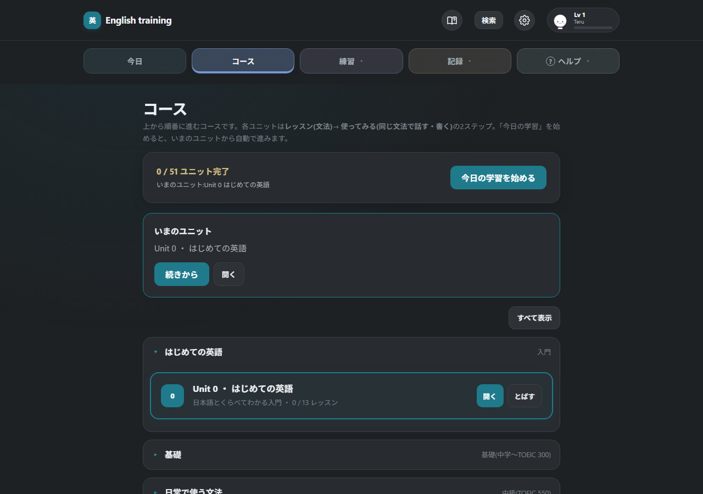
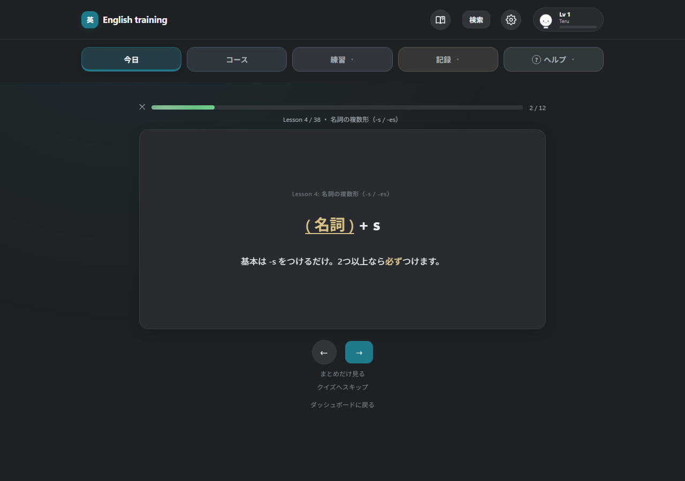
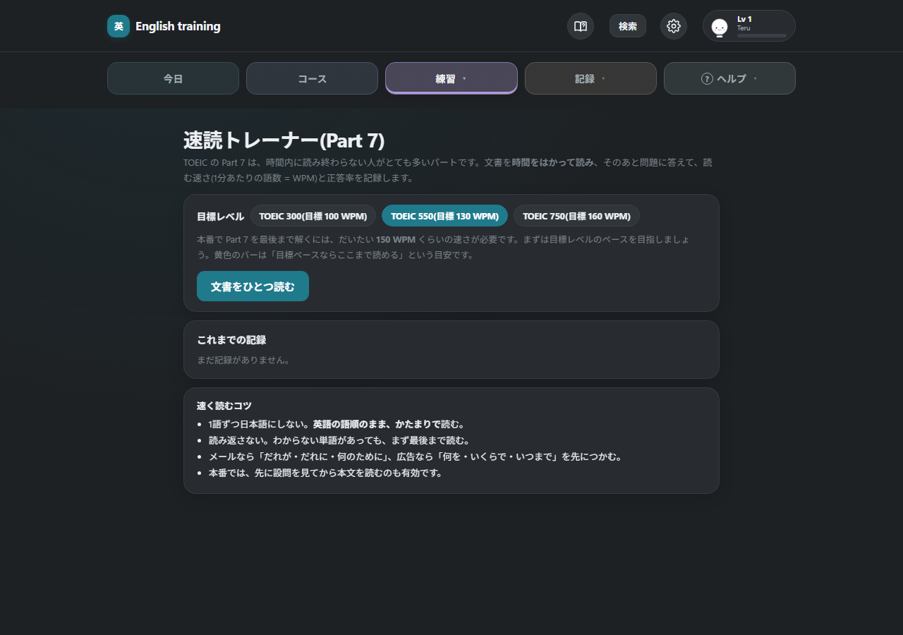
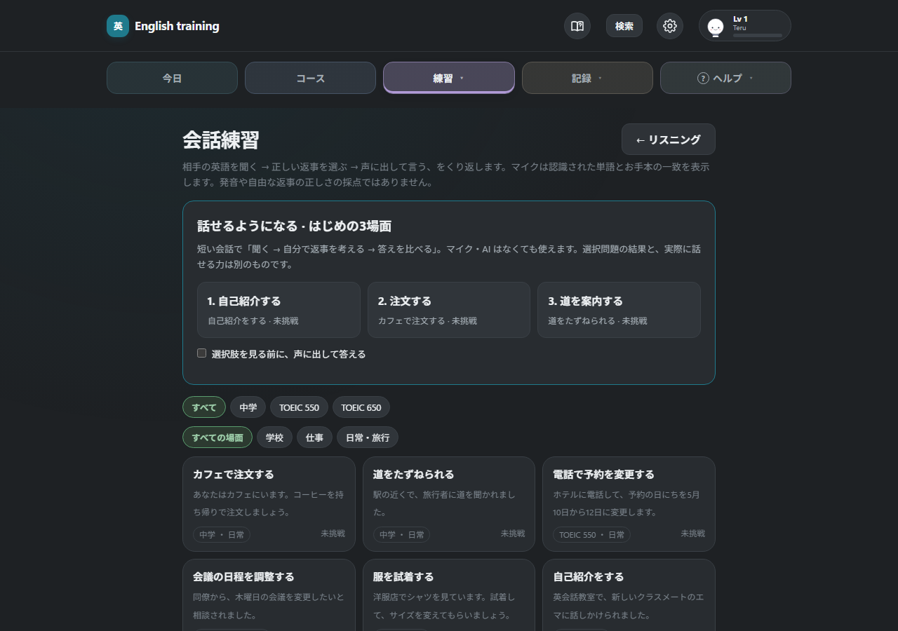
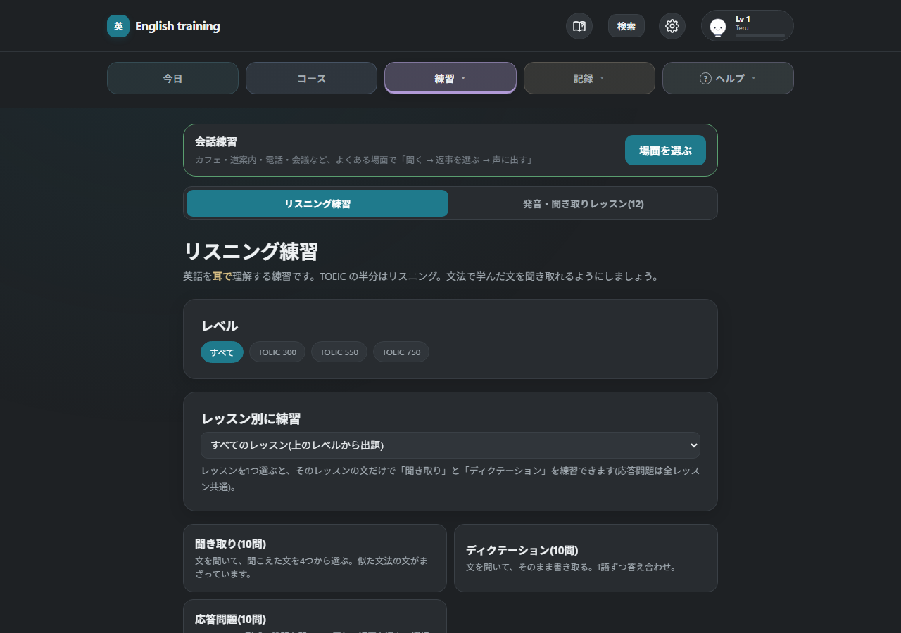
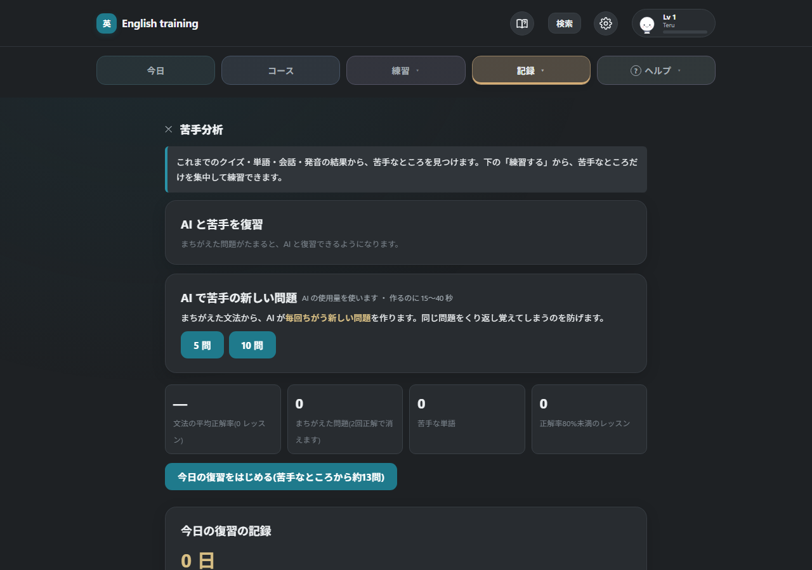

# 英語トレーニング — 使い方ガイド

## 目次

- [1. このサイトについて](#about)
- [2. 今日(ホーム) — 毎日のスタート地点](#today)
- [3. コース — Unit 0〜38 を順番に](#course)
- [4. レッスン(スライド)](#lesson)
- [5. クイズ — すべての選択肢に解説](#quiz)
- [6. TOEIC 練習(Part 1〜7)](#toeic)
- [7. 本番形式の模試](#mock)
- [8. 速読トレーナー(Part 7)](#speed)
- [9. バトル — 文法ゲーム](#battle)
- [10. 会話練習(40場面)](#kaiwa)
- [11. 発音チェック](#hatsuon)
- [12. リスニング練習](#listen)
- [13. 単語](#vocab)
- [14. 苦手分析と復習](#weak)
- [15. 学習の統計](#stats)
- [16. てるのお世話(My Teru)](#teru)
- [17. AI チャット(任意・自分のキー)](#ai)
- [18. 設定(⚙)・検索・ヘルプ](#settings)

## 1. このサイトについて
_場所: 概要_

日本人学習者のための英語トレーニングサイトです。HTMLファイル1つだけで動き、サーバーもインストールも不要。EdgeまたはChromeで開けばすぐ使えます。38レッスン・約1,060問の文法クイズ、40場面の会話練習、TOEIC 300/550/750の練習と本番形式の模試、文法バトルゲーム、発音チェック、苦手分析とSRS復習を搭載。マスコットの「てる」が毎日の学習を見守ります。学習記録はすべてブラウザ内に保存され、外部には送信されません。

### 使い方
- 「English training (enhanced).html」をダウンロード → EdgeかChromeでダブルクリック。それだけです。
- 単語の音声だけオンライン(Wikimedia Commons → なければ端末の音声合成)。ほかはオフラインで動きます。
- スマホでも同じファイルで動きます(320px幅から対応)。

### 知っておくべきこと
- **テーマ:** 初期設定はダーク。設定(⚙)でライト/自動に変更可。
- **キーボード:** Space/Enter で次へ、Backspace で戻る、「/」でホーム検索。
- **データ:** ブラウザのサイトデータを消すと記録も消えます。設定からエクスポート/インポートできます。
- **AI機能は任意:** 自分のAPIキー(Gemini/OpenAI/Anthropic/DeepSeek/xAI)を設定すると、クイズの振り返り・苦手の相談・チャットが可能。キーは端末内のみに保存。

## 2. 今日(ホーム) — 毎日のスタート地点
_場所: 今日 タブ_

毎日ここから始めます。「今日の学習を始める」を押すだけで、今日の復習 → いまのユニットのレッスン → 使ってみる → 単語・TOEIC・リスニングへと順番に自動で進みます(約30分)。始めると画面下にバーが出て「次へ・スキップ・一時停止・今日はここまで」がいつでも使えます。タイマーはなく、せかされません。

_今日タブ_

## 3. コース — Unit 0〜38 を順番に
_場所: コース タブ_

上から順番に進むコースです。各ユニットは「レッスン(文法)→ 使ってみる(同じ文法で話す・書く)」の2ステップ。入門(はじめての英語)→ 基礎(中学〜TOEIC 300)→ 日常で使う文法(TOEIC 550)→ 上級の順に並んでいます。「続きから」で前回の場所に戻れます。

_コースタブ_

## 4. レッスン(スライド)
_場所: コース → 開く_

1レッスンは10〜15枚のスライド。文法の「形」→ なぜそうなるか → 例文(音声つき)→ よくある間違い、の順です。矢印キーまたは Space で進みます。「まとめだけ見る」「クイズへスキップ」も選べます。

_レッスン4「名詞の複数形」のスライド_

## 5. クイズ — すべての選択肢に解説
_場所: レッスンのあと_

各レッスンに15問。英文と「日本語を見る」ボタン、辞書(文中の単語の意味)、音声(ふつう/ゆっくり/もう一度/速度)がついています。答えると正解が緑、自分の誤答が赤で表示され、下に「なぜ間違いか・どう直すか」の解説が出ます。復習問題(🔁 Review)が毎回混ざりますが、合格判定には数えません。80%以上で合格です。

_誤答したあとの画面_

## 6. TOEIC 練習(Part 1〜7)
_場所: 練習 → TOEIC 練習_

TOEIC L&R の全パートを短く練習できます。レベル(300/550/750)を選び、パートごとに10問前後。Part 1 は実写真(Wikimedia Commons)を見て4つの説明文から正しいものを選びます。すべての問題に日本語の解説つき。

_TOEIC 練習ページ_

## 7. 本番形式の模試
_場所: 練習 → 本番形式の模試_

本番と同じ順番・同じ形式。リスニングは1回だけ自動で流れ、リーディングは時間制限あり。最後に推定スコア(990点満点)とパート別正答率、全問の解説が出ます。フル(200問・約2時間)とハーフ(100問・約1時間)。※このサイトでタイマーがあるのは模試と速読だけです。

_模試の入口_

## 8. 速読トレーナー(Part 7)
_場所: 練習 → 速読_

時間内に Part 7 を読み終わらない人のためのトレーナー。文書を時間をはかって読み、問題に答え、WPM(1分あたりの語数)と正答率を記録します。目標レベルごとの目安 WPM と、速く読むコツも表示。

_速読トレーナー_

## 9. バトル — 文法ゲーム
_場所: 練習 → バトル_

モンスターが歩いてくる間に文法問題に答えるゲーム。6ステージ(冠詞 / 前置詞 / 三単現 / 不規則過去形 / 疑問文 / 疑問詞)+ 数と量・比較、エンドレスモード。難易度3段階。間違えると時間が止まり、1行のルールが2秒表示されます。10体倒すとボス。XPとてるのごはんがもらえ、連続学習日数にも数えられます。

_バトルのステージ選択_

## 10. 会話練習(40場面)
_場所: 練習 → リスニング → 会話練習_

相手の英語を聞く → 正しい返事を選ぶ → 声に出して言う、をくり返します。カフェ・道案内・電話・会議・買い物など40場面・120ターン。答えたあとに「ほかにも自然な言い方」が2つ表示されます。マイクを使うと認識された単語とお手本の一致を表示(採点ではありません)。間違えた場面は、ほかの場面の中に復習として再登場します。

_会話練習_

## 11. 発音チェック
_場所: 練習 → 発音チェック_

実際の人の録音(お手本)を聞く → 録音ボタンで同じように言う → 2つの波形を見くらべます。波の長さと強く言う場所が近いほど、お手本に近い発音です。単語モードとシャドーイング(文)モード。マイクの許可が必要です。

_発音チェック_

## 12. リスニング練習
_場所: 練習 → リスニング_

英語を耳で理解する練習。レベルを選び、聞き取り(10問)・ディクテーション(10問)・応答問題(10問)。レッスンを1つ選ぶと、そのレッスンの文だけで練習できます。似た文法の文が選択肢に混ざるので、文法で学んだ形を聞き分ける力がつきます。

_リスニング練習_

## 13. 単語
_場所: 練習 → 単語_

5レベル・約1,300語をフラッシュカードで覚え、忘れかけたころに自動で復習(SRS)。「知らない/むずかしい/覚えた」の3択で記録。毎日10語ずつ。英→日、日→英の両方向。

_単語ページ_

## 14. 苦手分析と復習
_場所: 記録 → 苦手分析_

クイズ・単語・会話・発音の結果から苦手なところを見つけ、そこだけ集中して練習できます。「今日の復習をはじめる」は苦手なところから約13問。AIキーがあれば、間違えた文法から毎回ちがう新しい問題を AI が作ります(同じ問題を暗記してしまうのを防ぐ)。

_苦手分析_

## 15. 学習の統計
_場所: 記録 → 統計_

レベル・XP、習得レッスン数、学習日数と連続日数、文法クイズの正解率。1日の学習時間・週の日数・目標TOEIC点数から「目標までの見込み」を計算します。AIキーがあれば学習データ全体からアドバイスももらえます。

_学習の統計_

## 16. てるのお世話(My Teru)
_場所: 右上の Teru をクリック_

マスコット「てる」。学習するとXPとごはんがもらえ、レベルが上がって成長します(てるてる見習い → ... → おひさまてる)。おなか・きぶん・せいけつ・体調・ねむりの状態があり、名前をつけたりアクセサリー(帽子・めがね・羽など35種)をドラッグで着せたりできます。クリックでなでる、上にドラッグで天気が変わります。

_てるのお世話_

## 17. AI チャット(任意・自分のキー)
_場所: 練習 → AI チャット_

AIを相手に文字で会話練習。レベル(中学/日常/仕事・TOEIC)と場面(自己紹介・カフェ・ホテル・道案内・会議など15場面)を選びます。間違いを直してもらう、日本語訳をつける、のオプションあり。設定→AIで自分のAPIキー(Gemini / OpenAI / Anthropic / DeepSeek / xAI)を入れると使えます。キーがなくても「会話の指示」がコピーされるので、ChatGPTなどに貼って同じ練習ができます。キーは端末の localStorage にのみ保存。

_AI チャット_

## 18. 設定(⚙)・検索・ヘルプ
_場所: ヘッダー右上_

⚙ 設定: テーマ(ダーク/ライト/自動)、アクセントカラー、音声の速さ、AIキー、データのエクスポート/インポート。検索: レッスン・文法・単語を横断検索(「/」キーでも開く)。ヘルプ: 学び方ガイド、ページの使い方(各ページの i で再表示)、ツアー、更新情報。

## ライセンス・注意
- 個人学習用。TOEIC Part 1 の写真は Wikimedia Commons 由来(各写真の下にクレジットとライセンスを表示)。てるのイラスト・食べ物・アクセサリー画像は AI 生成のため、商用利用前に差し替えが必要。

---
*最終更新: 2026-11-26*
